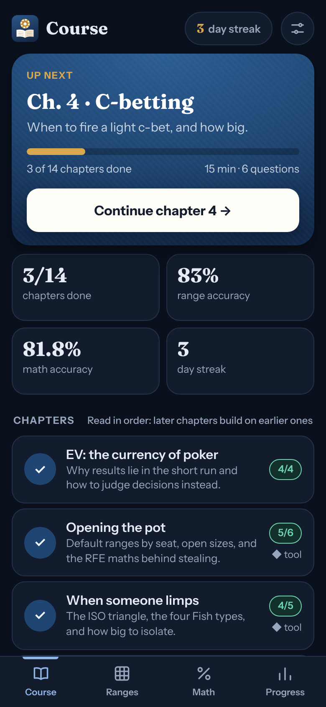
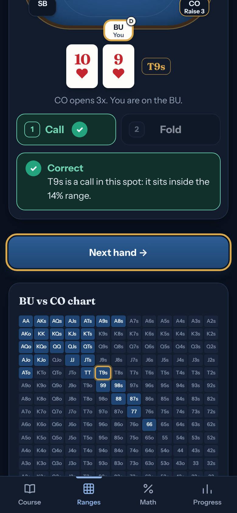

# Grinder’s Manual Trainer

**A pocket study companion for *The Grinder’s Manual* (Peter Clarke).** Fourteen chapter lessons with quizzes, a range trainer on a real poker table and math drills.

**[Open the app](https://hail75.github.io/grinders-manual/)** · works offline · installable · no account, no tracking

<p>
  
  
  
</p>

## What it does

- **Course.** Fourteen lessons in the book’s chapter order, each split into short parts with a progress bar, then a quiz. Missed questions are listed with the answer at the end.
- **Interactive tools** inside the lessons: steal calculator, ISO sizing, bet size vs required fold equity, required equity, the value-bet flowchart and a 3-bet shape helper.
- **Range trainer.** The book’s default opening ranges (Ch. 2) and calling ranges (Ch. 6) dealt on a six-seat table: who folded, who raised, the blinds and the pot in chips, and your two cards. Raise, call or fold, then the chart opens with your hand marked. 60% of hands come from the edge of the range, where the decisions are. *Mix* deals random spots from a group.
- **Math drills.** Endless required fold equity, equity to call, outs to equity, combined fold equity and combo questions, with the milestone table alongside.
- **Progress.** Chapters done, best quiz scores, accuracy per range spot and per drill, and a 16-week study calendar with your streak.
- **Phone first.** One-hand layout with a bottom tab bar and the main button within thumb reach; a sidebar and two-column drills on a wide screen. Light and dark themes. Keyboard: 1–4 answer, Enter next, ← → turn lesson pages, R / F in the range trainer.

<p></p>

## Install on a phone

Open the link in Chrome or Safari, then **Install app** or **Add to Home Screen**. It runs full screen and keeps working without a connection.

Progress (lessons, quiz scores, drill stats) is stored on the device. **Settings → Export** saves it to a file; **Import** restores it on another device.

## Under the hood

- One file, [`index.html`](index.html): HTML, CSS and plain JavaScript. No framework, no build step, no dependencies.
- [`sw.js`](sw.js) and [`manifest.webmanifest`](manifest.webmanifest) make it an offline, installable app. Fonts (Fraunces and Instrument Sans, SIL Open Font License) are bundled in [`fonts/`](fonts/).
- [`icon.svg`](icon.svg) is the one source for the logo; the PNG icons are rendered from it.

```bash
node tests/verify.mjs      # content and integrity checks, must print "All checks passed"
python3 -m http.server 8000  # then open http://localhost:8000
```

## Notes

Lesson text is a summary in our own words; the book itself is not included.
