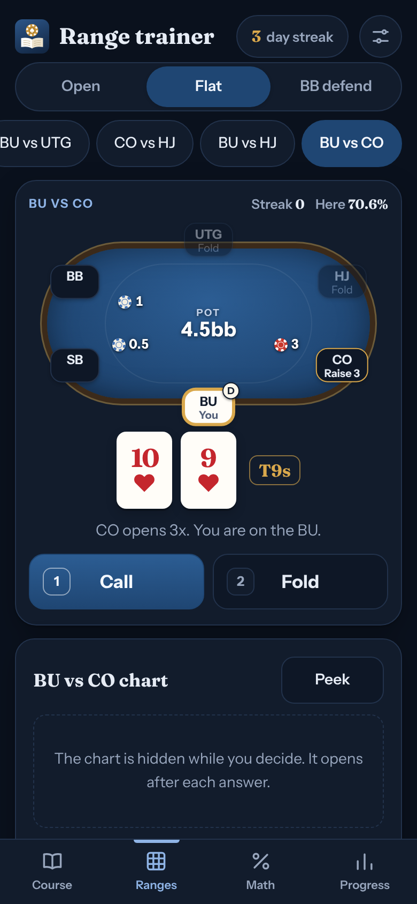
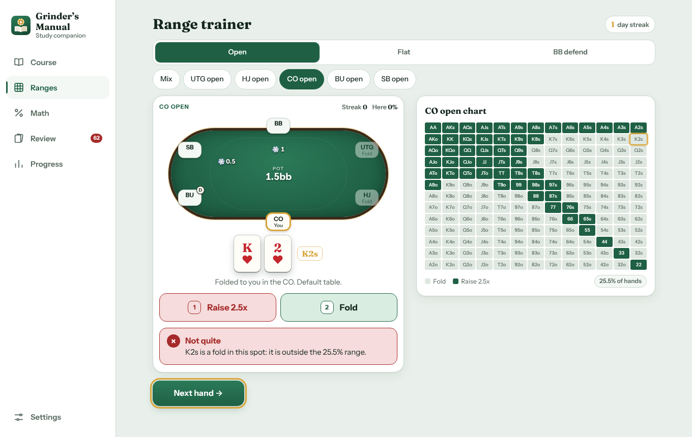

# Grinder’s Manual Trainer

**A pocket study companion for *The Grinder’s Manual* (Peter Clarke).** Fourteen chapter lessons with quizzes, a trainer that deals endless pre-flop and post-flop spots on a real poker table, and math drills.

**[Open the app](https://hail75.github.io/grinders-manual/)** · works offline · installable · no account, no tracking

<p>
  
  
  
</p>

## What it does

- **Course.** Fourteen lessons in the book’s chapter order, each split into short parts with a progress bar, then a quiz. Missed questions are listed with the answer at the end.
- **Interactive tools** inside the lessons: steal calculator, ISO sizing, bet size vs required fold equity, required equity, the value-bet flowchart and a 3-bet shape helper.
- **Trainer, pre-flop.** 42 spots read cell by cell from the book’s charts, dealt on a six-seat table with who folded, raised, called or 3-bet, the blinds and the pot in chips, and your two cards. Groups: **Open** (default, fish/nit hunting and defensive ranges), **Flat** and **BB defend** (Ch. 6's calling charts, including the SB spots and calls by open size, with Ch. 10's value 3-bets on top: 3-bet / call / fold), **3-bet** (polar, linear and squeeze ranges from Ch. 10) and **vs 3-bet** (4-bet / call / fold defences from Ch. 11). The chart opens after each answer with your hand marked. Chart colours mean the same thing everywhere: navy = raise (open, 3-bet, squeeze, 4-bet, shove), teal = call, grey = fold, lighter shades for the extra or bluff tiers. 60% of hands come from the edge of the range, where the decisions are. *Mix* deals random spots from a group.
- **Trainer, post-flop.** Endless spots generated by code. **C-bet** (Ch. 4: in position, out of position, multiway): check, or bet ½, ⅔ or pot. The answer comes from the book’s seven factors (texture type 1-5, equity from outs, opponent type and his Fold to F Cbet, showdown value, players, turn prospects, position) and the Figure 22 sizing guide, balanced against Regs and unbalanced against Fish. **Value bet** (Ch. 5: turn and river): the three questions (relative hand strength, building the pot, slowplaying) and sizing by elasticity. After each answer: why, why not your pick, and the read (factor checklist, expected vs needed folds, sizing zone, or the three questions).
- **Spaced repetition.** Every trainer topic: a missed spot comes back in the topic you’re drilling 3-4 spots later, then ~15 spots later, then after 1, 3 and 7 days, at most one spot in four. A right answer moves it up a step, a miss starts it again.
- **Math drills.** Endless required fold equity, equity to call, outs to equity, combined fold equity and combo questions, with the milestone table alongside.
- **Progress.** This week (answers, accuracy, days studied), what to work on next (reviews due, weakest trainer spots, quizzes to retake, weak math drills, groups not tried), the trainer by group, math drill tiles and a 16-week activity calendar. Chapter scores stay on the Course tab.
- **Phone first.** One-hand layout with a bottom tab bar and the main button within thumb reach; a sidebar and two-column drills on a wide screen. Light and dark themes. Keyboard: 1–4 answer, Enter next, ← → turn lesson pages, R / C / F in pre-flop spots.

<p></p>

## Install on a phone

Open the link in Chrome or Safari, then **Install app** or **Add to Home Screen**. It runs full screen and keeps working without a connection.

Progress (lessons, quiz scores, drill stats) is stored on the device. **Settings → Export** saves it to a file; **Import** restores it on another device.

## Under the hood

- One file, [`index.html`](index.html): HTML, CSS and plain JavaScript. No framework, no build step, no dependencies.
- [`sw.js`](sw.js) and [`manifest.webmanifest`](manifest.webmanifest) make it an offline, installable app. Fonts (Fraunces and Instrument Sans, SIL Open Font License) are bundled in [`fonts/`](fonts/).
- [`icon.svg`](icon.svg) is the one source for the logo; the PNG icons are rendered from it.

```bash
node tests/verify.mjs      # content and integrity checks, must print "All checks passed"
python3 -m http.server 8000  # then open http://localhost:8000
```

## Notes

Lesson text is a summary in our own words; the book itself is not included.
